# 🌱 FieldShift AI

> **NASA Space Apps Challenge 2026** — *Field Shift: Adapting Farms with NASA Data*  
> **Team:** ChungusReloaded (Solo Development)  
> **Pilot Region:** Kerala, India (Global Scope via Multi-Region Presets)  
> **Version:** v4.0 Production

FieldShift AI is an agricultural decision-support platform that transforms NASA Earth observations into actionable smallholder adaptation decisions. For each registered field, it builds a predictive **digital twin** combining satellite observations, soil intelligence, terrain hydrology, and local agronomic knowledge — powering multi-year rotation optimization with side-by-side trade-offs, climate shock What-If stress testing, conversational AI assistance, condition-triggered tasks, exportable farm dossiers, and smallholder carbon credit readiness.

```text
NASA Earth Data → Environmental Analysis → Farm Digital Twin → Crop Suitability
    → Rotation Optimization → AI Guidance → Actionable Farm Tasks → Carbon Credits
```

---

## ⚡ One-Command Setup (Docker Compose)

Get the complete FieldShift platform running with a single command:

```bash
# 1. Clone repository
git clone https://github.com/AbelThomasAnil/FieldShift.git
cd FieldShift

# 2. Run with Docker Compose
docker compose up --build
```

- **Frontend Application:** [http://localhost:3000](http://localhost:3000)
- **FastAPI Backend & Interactive Swagger:** [http://localhost:8000/docs](http://localhost:8000/docs)
- **Scientific Health Probe:** [http://localhost:8000/api/health](http://localhost:8000/api/health)

### Demo Farmer Accounts (Pre-Seeded)
Judges can instantly log in and evaluate pre-seeded benchmark farms without drawing polygons:
- **Farmer 1:** `thomas.kerala@fieldshift.ai` (Kanjirappally Valley Farm, 2.1 acres, Robusta Banana)
- **Farmer 2:** `ananya.wayanad@fieldshift.ai` (Wayanad Highland Coffee & Spices, 3.4 acres)
- Or simply click the **"🌱 Demo Farm"** button in the header at any time!

---

## 🏆 Key Challenge Alignments (Judge Scoring Criteria)

| Feature | Challenge Alignment & Scientific Purpose | Implementation |
|---|---|---|
| **Side-by-Side Strategy Comparison** | Direct multi-criteria evaluation of 3 distinct rotation strategies (A: Soil Health, B: Water Efficiency, C: Balanced) across N credit, water savings, income, and pest disruption. | Interactive comparative matrix + 3-year Soil Organic Carbon (SOC %) projection chart in `/rotation`. |
| **Multi-Strategy Climate What-If** | Connects the predictive digital twin directly with rotation strategies, simulating how Strategies A, B, and C hold up under a -40% monsoon drought or +35% flood shock. | Interactive slider & presets with real-time resilience scoring (0–100) and physiological impact summaries. |
| **Dynamic Farmer Priority Input** | Directly operationalizes the challenge's 4th input by letting farmers choose priorities (Soil Health, Water Saving, Income, Low Labor) to dynamically re-rank strategies with an explanatory "Why this one" rationale. | Dynamic priority chips triggering backend re-ranking and highlight banner. |
| **Long-Term NASA Baseline Anomaly** | Replaces a static 30-day precipitation number with a multi-year climatological comparison against NASA POWER / IMERG 30-year normal, outputting exact percentage anomalies (`+40% above normal`) and adaptation guidance. | Climatology baseline cards & surplus/deficit alert badges in `/earth-intelligence`. |
| **Kerala Seasonal Monsoon Windows** | Tailors crop rotation advice to Kerala's agro-climatic calendar: **Virippu** (Autumn / Kharif: May–Aug), **Mundakan** (Winter / Rabi: Sep–Dec), and **Puncha** (Summer: Jan–May). | Monsoon window badges and duration breakdowns on each crop profile. |
| **Transparent Score Breakdown Bar** | Renders the exact 5-factor weighting on each crop card: Soil (25%), Climate (25%), Water (20%), Drainage (15%), Season (15%). | Multi-segment proportional stacked progress bars explaining crop suitability scores. |
| **Data Trust Badges & Honest Limits** | Every NASA card displays a Live, Cached, or Regional Model status badge, last updated timestamp, source link, and explicit coarse footprint warning (`SMAP: Regional Estimate ~9 km`). | Provenance headers and metadata badges on all telemetry widgets. |
| **Local Smallholder Units** | First-class unit switcher supporting Hectares, Acres, and **Kerala Cents** (100 cents = 1 acre), the primary land unit used by southern Indian smallholders. | Global header pill toggle with live recalculation across the platform. |
| **Bilingual UI Localization** | Whole-UI internationalization toggle supporting **English** and **Malayalam (മലയാളം)** for smallholder accessibility. | UIContext translation engine with instant toggle in the top bar. |
| **Scientific Data Attribution** | Formal credit and license attribution for NASA GPM, NASA POWER, NASA SMAP, Landsat 8/9, Sentinel-2, ISRIC SoilGrids (CC BY 4.0), OpenStreetMap, MapLibre, KAU, and ICAR. | Dedicated `/attribution` registry. |

---

## 🛠️ Architecture & Data Flow

```mermaid
flowchart TD
    subgraph SATELLITE["🛰️ NASA Earth Observations & Soil Grids"]
        GPM["NASA GPM IMERG v07<br/>(Daily Precipitation)"]
        POWER["NASA POWER Agroclimatology<br/>(Temp, Solar, Humidity)"]
        SMAP["NASA SMAP L4 Global<br/>(9 km Regional Moisture)"]
        LANDSAT["Landsat 8/9 & Sentinel-2<br/>(NDVI / NDMI Canopy Vigor)"]
        SOIL["ISRIC SoilGrids 250m<br/>(pH, SOC, Texture, Bulk Density)"]
    end

    subgraph ENGINE["⚙️ FieldShift FastAPI Backend Engine"]
        FARM_MGR["Multi-Tenant Farm Manager<br/>(JWT Isolation & WGS84 Geodesic)"]
        CLIMATOLOGY["NASA 30-Year Climatology Engine<br/>(Rainfall Anomaly vs Normal)"]
        SUITABILITY["5-Factor Weighted Scorer<br/>(25% Soil, 25% Climate, 20% Water, 15% Drain, 15% Season)"]
        OPTIMIZER["Multi-Year Rotation Optimizer<br/>(A: Soil Health, B: Water, C: Balanced)"]
        DIGITAL_TWIN["Predictive Digital Twin<br/>(Climate Shock What-If Simulation)"]
    end

    subgraph UI["💻 Next.js 16 Responsive Frontend"]
        DASH["Earth Intelligence Dashboard<br/>(Status Badges, Anomaly & Footprint Notes)"]
        ROTATION_UI["Side-by-Side Comparison Matrix<br/>(A vs B vs C & 3-Year Soil Chart)"]
        WHATIF_UI["Multi-Strategy What-If Simulator<br/>(-40% Drought vs +35% Flood)"]
        ASSISTANT["Multilingual AI Assistant<br/>(Voice STT/TTS & Deterministic Tools)"]
        ATTRIBUTION["Scientific Attribution Registry<br/>(CC BY 4.0, NASA Open Data, KAU/ICAR)"]
    end

    SATELLITE --> ENGINE
    ENGINE --> UI
```



---

## 🧪 Automated Test Suite (13/13 Passing)

FieldShift maintains a strict test suite covering agronomic algorithms, multi-tenant isolation, and data trust standards:

```bash
# Run tests from project root
$env:PYTHONPATH="backend"
.\backend\venv\Scripts\python.exe -m pytest backend/tests -v
```

```text
backend/tests/test_assistant.py .                                        [  7%]
backend/tests/test_carbon.py .                                           [ 15%]
backend/tests/test_environment.py .                                      [ 23%]
backend/tests/test_farms_auth.py .                                       [ 30%]
backend/tests/test_integrated_farming.py .                               [ 38%]
backend/tests/test_judge_improvements.py .....                           [ 76%]
backend/tests/test_rotation_digital_twin.py .                            [ 84%]
backend/tests/test_soil_terrain_crops.py .                               [ 92%]
backend/tests/test_tasks_reports.py .                                    [100%]

======================= 13 passed in 29.28s =======================
```

### Key Verification Tests in `test_judge_improvements.py`:
1. `test_usda_soil_ph_thresholds`: Verifies standard USDA classes (pH 6.1–6.5 is *Slightly Acidic*, 5.6–6.0 is *Moderately Acidic*).
2. `test_fixed_currency_exchange_rate_constant`: Verifies named currency constant `₹83/USD` is enforced for carbon calculations.
3. `test_multi_tenant_jwt_isolation_privacy`: Verifies strict tenant privacy where User B requesting User A's farm ID returns HTTP 403 Forbidden across all endpoints.
4. `test_rotation_priority_re_ranking`: Verifies farmer priority chips (`water_saving`, `soil_health`, `income`, `labor`) successfully re-rank strategies and generate tailored "Why this one" rationales.

---

## 💻 Manual Local Development Setup

### 1. Backend Setup (FastAPI at `:8000`)
```bash
cd backend
python -m venv venv
.\venv\Scripts\Activate.ps1   # On Linux/macOS: source venv/bin/activate
pip install -r requirements.txt
python ../scripts/seed_demo_data.py
python -m uvicorn app.main:app --host 0.0.0.0 --port 8000 --reload
```

### 2. Frontend Setup (Next.js at `:3000`)
```bash
cd frontend
npm install
npm run dev
```

---

## 🔒 Scientific Integrity Safeguards

1. **Suppression of Synthetic Recommendations Without Physical Lab Tests:** Synthetic N-P-K mineral fertilizer dosages are withheld until a certified soil lab report is registered. Satellite and SoilGrids estimates provide organic amendments and liming advice only.
2. **Honest Footprint Disclaimers:** 9 km SMAP passive microwave and 0.1° GPM IMERG estimates are explicitly labeled as *"Regional Estimates"* on every screen to prevent misleading smallholders with 1-acre plots.
3. **Conservative Carbon Revenue Headlines:** Headline carbon return figures display the conservative lower bound rather than optimistic maximums, clearly stating that smallholder credit monetization requires collective FPO pooling.
4. **Deterministic Agronomic Rules:** The conversational AI assistant executes deterministic Python tool calls against live telemetry rather than generating unverified advice.

---

## 👥 Authors & Competition

- **Team:** ChungusReloaded (Solo Development)
- **Competition:** NASA International Space Apps Challenge 2026
- **Challenge Track:** Field Shift: Adapting Farms with NASA Data
- **License:** Open Source under MIT License (see `LICENSE`)
