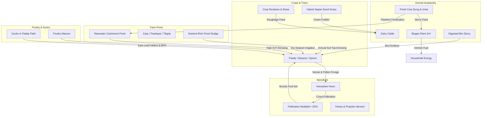

# FieldShift AI: Comprehensive System Architecture & Integrated Farming Systems (IFS) Specification

> **Project:** FieldShift AI  
> **Challenge:** NASA Space Apps Challenge 2026 — *Field Shift: Adapting Farms with NASA Data*  
> **Team:** ChungusReloaded (Solo Development)  
> **Pilot Region:** Kerala, India (Global Scope via Modular Region Packs)  
> **Document Version:** 4.0 — Unified Full Architecture with Circular Integrated Farming System (IFS)  
> **Date:** 14 November 2026  

---

## 1. Executive Vision & The Circular Integrated Farm

Smallholder farmers (typically operating 1–3 acres in tropical and subtropical regions) face severe vulnerability when relying on single-crop monocultures. Climate shocks, monsoon anomalies, and volatile commodity prices threaten household food security and economic survival.

**FieldShift AI** is an agricultural intelligence and decision-support platform that transforms **NASA Earth observations** into farm-level climate adaptation decisions. 

In Version 4.0, FieldShift AI expands from field crops into a **Fully Integrated Farming System (IFS)**. By linking crop cultivation with **Animal Husbandry (Dairy & Cattle)**, **Farm Pond Aquaculture (Pisciculture)**, **Poultry & Duck Rearing**, and **Apiculture (Bee Farming)**, the platform models a **zero-waste, circular bio-resource ecosystem**.

```
                           ┌──────────────────────────────┐
                           │   NASA Earth Observations    │
                           │ GPM · POWER · SMAP · Landsat │
                           └──────────────┬───────────────┘
                                          │
                                          ▼
                           ┌──────────────────────────────┐
                           │   Farm Digital Twin Engine   │
                           │ Soil · Terrain · Microclimate│
                           └──────┬────────────────┬──────┘
                                  │                │
            ┌─────────────────────┴──────┐  ┌──────┴────────────────────┐
            ▼                            ▼  ▼                           ▼
┌────────────────────────┐  ┌─────────────────────────┐  ┌────────────────────────┐
│ Crop Engine & Rotation │  │  Livestock & Fodder     │  │ Farm Pond Aquaculture  │
│  - 18 Regional Crops   │  │  - Dairy Cattle (THI)   │  │  - Rainwater Storage   │
│  - 3-Year Rotation     │  │  - Manure & Biogas Loop │  │  - Composite Carp/GIFT │
│  - Legume N₂ Fixation  │  │  - Bund Fodder Grasses  │  │  - Rice-Fish Systems   │
└───────────┬────────────┘  └────────────┬────────────┘  └───────────┬────────────┘
            │                            │                           │
            │      ┌─────────────────────┴───────────────┐           │
            │      ▼                                     ▼           │
┌───────────┴────────────┐                     ┌─────────────────────┴────────────┐
│ Poultry & Duck Systems │                     │  Apiculture (Bee Farming)        │
│  - Paddy Pest Control  │                     │  - Pollination Multiplier (+25%) │
│  - High-P Organic FYM  │                     │  - Honey & Propolis Revenue      │
└───────────┬────────────┘                     └─────────────┬────────────────────┘
            │                                                │
            └─────────────────────────┬──────────────────────┘
                                      │
                                      ▼
             ┌──────────────────────────────────────────────────┐
             │         Circular Bio-Resource Integration        │
             │   Zero Chemical Waste · Organic Carbon Recovery  │
             │   Diversified Revenue · Microclimate Resilience  │
             └──────────────────────────────────────────────────┘
```

---

## 2. Master System Module Breakdown

FieldShift AI is engineered as a **Modular Monolith** consisting of 11 deeply interconnected modules:

```text
├── Module 1:  Farm Geospatial Boundary & Geodesic Mapping Engine
├── Module 2:  NASA Earth Observation & Environmental Telemetry Pipeline
├── Module 3:  Soil Intelligence & Physical Lab Calibration Engine
├── Module 4:  Terrain Relief, Elevation & Drainage Hydrology Engine
├── Module 5:  Crop Knowledge Base & 5-Factor Weighted Suitability Engine
├── Module 6:  Multi-Year Crop Rotation Optimizer (Soil, Water, Balanced)
├── Module 7:  Predictive Farm Digital Twin & What-If Stress Simulator
├── Module 8:  Multilingual AI Farm Assistant with Voice STT/TTS & Diagnostics
├── Module 9:  Condition-Triggered Task Manager & Decision Dossier Export
├── Module 10: Smallholder Carbon Credit Readiness & FPO Aggregation Module
└── Module 11: Integrated Farming System (IFS) — Livestock, Fish, Poultry & Bees
```

---

## 3. Detailed Specifications: Modules 1 through 10

### Module 1: Farm Boundary & Geodesic Mapping Engine
- **Technology:** MapLibre GL JS, WGS84 Ellipsoidal Geodesics, JWT Authentication.
- **Capabilities:**
  - High-precision polygon delineation on satellite vector tiles.
  - Geodesic area computation (acres/hectares) accounting for Earth's oblateness.
  - Multi-tenant data isolation: User-specific authorization prevents unauthorized cross-tenant inspection (HTTP 403 Forbidden).

### Module 2: NASA Earth Observation & Telemetry Pipeline
- **Integrated Space Datasets:**
  - **NASA GPM IMERG v07:** Gridded 0.1° daily & 30-day cumulative precipitation (mm).
  - **NASA POWER:** Climatology & agroclimatology feeds (T2M 2-meter air temperature, relative humidity, all-sky surface solar irradiance).
  - **NASA SMAP L4:** Global 9 km surface (0–5 cm) and rootzone (0–100 cm) soil moisture anomalies.
  - **Landsat 8/9 OLI-2 & Sentinel-2 MSI:** 10 m–30 m Normalized Difference Vegetation Index (NDVI) for crop vigor and Normalized Difference Moisture Index (NDMI) for canopy water stress.

### Module 3: Soil Intelligence & Lab Calibration Engine
- **Baseline Data:** ISRIC SoilGrids 250m global database providing depth-stratified pH, organic carbon (SOC), sand/silt/clay fractions, cation exchange capacity (CEC), and bulk density.
- **Physical Lab Calibration:** Krishi Bhavan / Soil Testing Lab intake form. When verified physical soil test values are entered, they dynamically override satellite estimates.
- **Anti-Hallucination Nutrient Lock:** Synthetic N-P-K fertilizer doses are strictly suppressed until a certified lab test is on record.

### Module 4: Terrain Relief, Elevation & Drainage Hydrology Engine
- **Topography Data:** NASADEM / SRTM 30m digital elevation models.
- **Hydrological Metrics:**
  - Mean slope gradient in degrees and percentage.
  - Slope curvature and terrain roughness.
  - Flow accumulation and Topographic Wetness Index (TWI) to pinpoint micro-topographic waterlogging risk and runoff velocity.

### Module 5: Crop Knowledge Base & 5-Factor Suitability Engine
- **Crop Catalog:** 18 regional tropical crops and global staples (Banana, Rice, Cassava, Ginger, Turmeric, Maize, Cowpea, Green Gram, Black Gram, Groundnut, Okra, Sweet Potato, Wheat, Soybean, Potato, Sorghum, Tomato, Cotton).
- **Weighted Scoring Algorithm:**
  $$\text{Score} = w_{\text{clim}} S_{\text{clim}} + w_{\text{soil}} S_{\text{soil}} + w_{\text{water}} S_{\text{water}} + w_{\text{terr}} S_{\text{terr}} + w_{\text{dur}} S_{\text{dur}}$$
  Outputs an explainable score from 0 to 100 with categorical rankings: *Highly Suitable*, *Moderately Suitable*, *Marginal*, or *Unsuitable*.

### Module 6: Multi-Year Crop Rotation Optimizer
- **Objective:** Break continuous monocropping monoculture pest cycles, replenish organic matter, and optimize water demand.
- **Three Algorithmic Pathways:**
  1. **Strategy A (Soil Health Focus):** Enforces leguminous pulse inclusion (Cowpea/Green Gram) to fix 40–65 kg N/ha symbiotically.
  2. **Strategy B (Water Efficiency Focus):** Sequences lower water-demand crops aligned with historical NASA GPM monsoon onset.
  3. **Strategy C (Balanced Trajectory):** Equilibrates immediate market value, labor feasibility, and soil restoration.

### Module 7: Predictive Farm Digital Twin & What-If Stress Simulator
- **Virtual Farm Replica:** Synthesizes the active crop phenological stage with live soil, moisture, and rainfall telemetry.
- **Stress Perturbations:** Simulates climatic shocks:
  - Severe drought (-30% to -50% rainfall deficit).
  - Excessive monsoon deluge (+50% rainfall, waterlogging).
  - Heat stress (+2°C to +4°C temperature shift).
  - Monsoon onset delay (14–28 days).
- Recalculates projected yield impacts, vulnerability hot-spots, and adjusted risk ratings.

### Module 8: Multilingual AI Farm Assistant
- **Provider-Independent Engine:** Local deterministic tool-calling dispatcher with optional Google Gemini LLM integration.
- **Multilingual Support:** English, Malayalam (മലയാളം), Hindi (हिन्दी), Tamil (தமிழ்), and Spanish (Español).
- **Voice STT & TTS:** Browser Web Speech API for voice recording and audio read-aloud.
- **Specific Crop Diagnostics:** Evaluates user-specified crops (e.g. Cashew, Coffee, Rubber, Nutmeg, Apples) against farm telemetry, explaining exact pros, cons, disease vulnerabilities (Blossom Blight, Tea Mosquito Bug), and better site-adapted alternatives.

### Module 9: Condition-Triggered Task Manager & Decision Dossier
- **Alert Generator:** Monitors telemetry against agronomic thresholds (e.g. prolonged dry spells, soil acidity under pH 5.5, high humidity disease windows).
- **Decision Dossiers:** Generates a unified, printable markdown report consolidating satellite observations, soil tests, rotation roadmaps, active tasks, and carbon eligibility.

### Module 10: Carbon Credit Readiness & FPO Aggregation
- **Methodology Screening:** Verra VCS VM0042 (Improved Agricultural Land Management), Gold Standard Soil Organic Carbon, and UNFCCC CDM AMS-III.AU (Rice Methane Abatement).
- **Conservative Yield Calculator:** Models gross carbon credits, deduces 25–40% aggregator/verifier commissions, and displays net farmer returns as conservative ranges.
- **FPO Aggregation:** Provides evidence ledgers and submission packs for smallholders pooling 1–3 acre fields into viable carbon clusters.

---

## 4. Module 11: The Integrated Farming System (IFS) Module

The Integrated Farming System (IFS) module models the biological, nutritional, and financial synergies between field crops, livestock, aquaculture, poultry, and apiculture.

### 4.1 Sub-Module 11.1: Dairy & Cattle Husbandry Engine

#### Agronomic Principles:
- A single adult cow produces 10–12 kg of fresh dung and 20–25 liters of urine daily, yielding **3.5 to 4.5 metric tons of Farm Yard Manure (FYM)** annually.
- Recycling cattle manure back to the field restores soil organic carbon (SOC), increases microbial biomass, and buffers acidic laterite soils.
- Installing a 2 m³ domestic biogas plant converts dung into clean methane gas for household cooking, while the **digested slurry (rich in ammoniacal nitrogen)** serves as a potent bio-fertilizer.

#### NASA Telemetry Integration:
- **Temperature-Humidity Index (THI) for Livestock Heat Stress:**
  Using NASA POWER ambient temperature ($T$ in °C) and Relative Humidity ($RH$ in %):
  $$\text{THI} = 0.8 \times T + \left(\frac{RH}{100}\right) \times (T - 14.4) + 46.4$$
  - $\text{THI} < 72$: Normal (No thermal stress).
  - $72 \le \text{THI} < 78$: Mild Heat Stress (Milk yield drops by 5–10%; respiration increases).
  - $78 \le \text{THI} < 89$: Moderate to Severe Stress (Milk yield drops by 15–25%; reproductive failure).
  - $\text{THI} \ge 89$: Emergency (Risk of heat stroke and mortality).
- **Automated Advisory:** When THI exceeds 74, FieldShift AI triggers alerts to provide shed ceiling fans, misters/foggers, cold drinking water, and night feeding schedules.

#### Fodder Crop Sizing:
- Calculates bund and boundary area required for **Hybrid Napier (CO-5)**, Guinea grass, and fodder cowpea:
  - 1 dairy cow requires 25–30 kg green fodder daily = ~10–12 tons/year.
  - Sized for 5–8 cents (0.05–0.08 acres) of high-density Napier grass along field perimeters.

---

### 4.2 Sub-Module 11.2: Farm Pond Aquaculture & Rainwater Harvesting

#### Agronomic Principles:
- A farm pond serves a vital dual function:
  1. **Rainwater Retention Basin:** Captures torrential monsoon runoff, mitigating slope erosion and recharging localized groundwater aquifers.
  2. **Aquaculture Ecosystem:** Cultivates high-protein freshwater fish using organic farm residues.
- Pond silt/sediment, excavated annually, is enriched with decomposed organic matter, fish droppings, and nitrogen, making it a superior top-dressing for crops.

#### NASA Telemetry Integration:
- **Rainwater Harvesting Capacity Calculator:**
  Using NASA GPM IMERG 30-day cumulative precipitation ($P$ in mm) and farm area ($A$ in m²):
  $$\text{Harvestable Volume (m}^3) = A \times \left(\frac{P}{1000}\right) \times C_{\text{runoff}}$$
  *(Where $C_{\text{runoff}} = 0.35$ for gentle laterite slopes).*
  For a 2-acre farm experiencing 515 mm rainfall, harvestable runoff exceeds **1,400 m³ (1.4 million liters)**, easily maintaining a 150 m² farm pond throughout dry periods.

#### Species Selection & Stocking Models:
- **Composite Carp Culture:**
  - Surface Feeder: **Catla (*Catla catla*)** — 30% stocking ratio.
  - Column Feeder: **Rohu (*Labeo rohita*)** — 40% stocking ratio.
  - Bottom Feeder: **Mrigal (*Cirrhinus mrigala*)** — 30% stocking ratio.
- **High-Value Regional Species:**
  - **Pearlspot / Karimeen (*Etroplus suratensis*):** State fish of Kerala; commands premium market value (₹500–₹800/kg).
  - **GIFT Tilapia (Genetically Improved Farmed Tilapia):** High stocking density (10–15 fish/m²), rapid 5–6 month harvest cycle.
- **Pokkali Rice-Fish Synergy:**
  - Simulates traditional coastal rice-prawn/fish rotation: paddy cultivation during low-salinity monsoon (June–October), followed by prawn/fish filtration culture during saline dry season (November–April).

---

### 4.3 Sub-Module 11.3: Poultry & Duck Farming Integration

#### Agronomic Principles:
- **Deep Litter Poultry Manure:** Richer in phosphorus and nitrogen than any other animal manure ($3.0\% \text{ N}, 2.5\% \text{ P}_2\text{O}_5, 1.5\% \text{ K}_2\text{O}$). An ideal fertilizer for heavy feeders like Banana and Black Pepper.
- **Rice-Duck Mutualism:**
  - Releasing ducks into paddy fields 20–25 days after transplanting provides biological pest control.
  - Ducks feed voraciously on Brown Planthoppers (*Nilaparvata lugens*), leaf folder larvae, and aquatic weeds.
  - Continuous paddling action aerates root-zone water and stirs up soil nutrients, while duck droppings provide natural top-dressing, reducing chemical pesticide requirements to zero.

#### Breed Recommendations:
- **Poultry:** Dual-purpose backyard breeds (**Gramasree**, **BV-380**, **Kadaknath**) yielding 180–220 eggs/year plus meat.
- **Ducks:** Indigenous water-hardy breeds (**Chara** and **Chemballi** / Kuttanad Ducks) yielding 180–200 large eggs annually.

---

### 4.4 Sub-Module 11.4: Apiculture (Bee Farming) & Crop Pollination Synergy

#### Agronomic Principles:
- Honeybees are the primary ecological force multiplier in an integrated farm.
- Beyond honey and wax, their primary economic contribution is **cross-pollination efficiency**:
  - Nutmeg & Mace: +20% to +30% fruit set and reduced premature fruit drop.
  - Cashew: +25% to +35% hermaphrodite flower fertilization.
  - Coconut: Improved button set and reduced button shedding.
  - Coffee: +20% to +28% fruit set and bean weight.
  - Cucurbits & Vegetables: +30% to +50% yield with well-shaped fruits.

#### Species & Yield Specifications:
1. **Indian Honey Bee (*Apis cerana indica*):**
   - Housed in standard ISI A-type or Newton hives.
   - Recommended density: 4–6 hives per acre.
   - Yield: 8–15 kg of multi-floral raw honey per hive annually.
2. **Stingless Bee / Dammer Bee (*Tetragonula iridipennis* / Cheruthen):**
   - Housed in wooden boxes or bamboo poles.
   - Completely harmless; suited for homesteads and garden perimeters.
   - Yield: 0.5–1.5 kg of high-potency medicinal honey per hive annually.
   - Sells at premium farmgate prices (**₹1,500 to ₹2,500 per kg** in Kerala due to antimicrobial and medicinal properties).

#### Floral Calendar & Colony Management:
- Tracks seasonal nectar and pollen dearth periods using satellite greenness (NDVI):
  - Monsoon dearth (June–August): Supplementary feeding with 1:1 sugar syrup and pollen substitutes.
  - Honey flow seasons (rubber honey flow in January–March; spice flowering in September–November).

---

## 5. Whole-Farm Circular Bio-Resource Matrix



---

## 6. Full-Stack Data Models & REST API Architecture

### 6.1 Database Schema (SQLAlchemy Models)

```python
# app/models/integrated_farming.py

class LivestockProfile(Base):
    __tablename__ = "livestock_profiles"
    id = Column(String, primary_key=True)
    farm_id = Column(String, ForeignKey("farms.id", ondelete="CASCADE"), nullable=False)
    animal_type = Column(String, nullable=False) # "cattle", "goat", "poultry", "duck", "fish", "bees"
    breed_name = Column(String, nullable=False) # e.g. "Vechoor Cow", "Gramasree", "Apis cerana"
    unit_count = Column(Integer, default=1)
    daily_yield_metric = Column(String) # e.g. "12 litres milk/day", "15 eggs/day", "10 kg honey/year"
    manure_production_kg_day = Column(Float, default=0.0)
    feed_requirement_kg_day = Column(Float, default=0.0)
    biogas_linked = Column(Boolean, default=False)
    created_at = Column(DateTime, default=datetime.utcnow)

class FarmPondProfile(Base):
    __tablename__ = "farm_pond_profiles"
    id = Column(String, primary_key=True)
    farm_id = Column(String, ForeignKey("farms.id", ondelete="CASCADE"), nullable=False)
    surface_area_sqm = Column(Float, nullable=False)
    mean_depth_m = Column(Float, default=1.8)
    primary_fish_species = Column(String) # "Carp Composite", "Pearlspot", "GIFT Tilapia"
    stocking_density = Column(Integer)
    water_source = Column(String) # "Rainwater Runoff", "Spring", "Borewell"
    harvestable_capacity_m3 = Column(Float)

class ApicultureProfile(Base):
    __tablename__ = "apiculture_profiles"
    id = Column(String, primary_key=True)
    farm_id = Column(String, ForeignKey("farms.id", ondelete="CASCADE"), nullable=False)
    bee_species = Column(String, nullable=False) # "Apis cerana indica" or "Tetragonula iridipennis"
    hive_count = Column(Integer, default=4)
    target_pollination_crops = Column(JSON) # ["Nutmeg", "Coconut", "Vegetables"]
    annual_honey_yield_kg = Column(Float)
    estimated_pollination_value_inr = Column(Float)
```

### 6.2 REST API Endpoints (`/api/integrated-farming`)

| HTTP Method | Route | Description |
|---|---|---|
| `GET` | `/api/integrated-farming/{farm_id}` | Retrieves whole-farm IFS profile, circular flow balance, and livestock counts |
| `POST` | `/api/integrated-farming/{farm_id}/livestock` | Registers or updates livestock, poultry, and fish pond inventory |
| `GET` | `/api/integrated-farming/{farm_id}/thi-telemetry` | Calculates live cattle Heat Stress Index (THI) from NASA POWER data |
| `GET` | `/api/integrated-farming/{farm_id}/rainwater-pond` | Calculates harvestable pond storage from farm area & NASA GPM rainfall |
| `GET` | `/api/integrated-farming/{farm_id}/pollination-impact` | Models yield gains and additional revenue from bee hive deployment |
| `GET` | `/api/integrated-farming/{farm_id}/nutrient-balance` | Calculates FYM generated vs chemical fertilizer offset in kg/year and INR |

---

## 7. Frontend Dashboard Module Specifications (`/integrated-farming`)

The frontend features a dedicated **Integrated Farming System Dashboard** in the navigation shell:

1. **Circular Bio-Resource Flow Visualizer:**
   Interactive node-link graph showing real-time resource transfers between livestock, biogas, farm pond, bees, and field crops.
2. **Livestock & Cattle Heat Stress Monitor:**
   Live THI gauge connected to NASA POWER microclimate feeds. Displays active health alerts and ventilation/shade guidance.
3. **Rainwater Farm Pond Sizer:**
   Interactive volume estimator matching NASA GPM 30-day precipitation to pond capacity, irrigation run-time, and fish stocking densities.
4. **Apiculture & Pollination Multiplier Card:**
   Hive calculator displaying projected cross-pollination yield increases (+20%–35%) for active crops, plus honey revenue projections.
5. **Nutrient & Cost Savings Calculator:**
   Summary of synthetic N-P-K kilograms displaced by cattle FYM, poultry deep-litter manure, and bio-slurry, with net annual rupees saved.

---

## 8. Summary of Scientific & Practical Impact

| System Component | Standalone Monoculture Farm | FieldShift AI Integrated Farm |
|---|---|---|
| **Income Streams** | 1 (Single seasonal crop harvest) | 5 (Crops, Milk, Fish, Eggs/Meat, Honey) |
| **Fertilizer Input** | 100% purchased synthetic NPK | 60–80% displaced by cattle FYM, bio-slurry & poultry manure |
| **Pest Control** | Chemical insecticides & fungicides | Biological (Trichoderma, ducks in paddy, IPM bio-control) |
| **Pollination Efficiency** | Dependent on wild insects | Optimized (+25% yield boost via managed bee hives) |
| **Drought Buffer** | High vulnerability | Rainwater farm pond stores 1,000+ m³ for critical irrigation |
| **Climate Shock Resilience**| Severe risk of total crop loss | High resilience; diversified allied biological assets |
